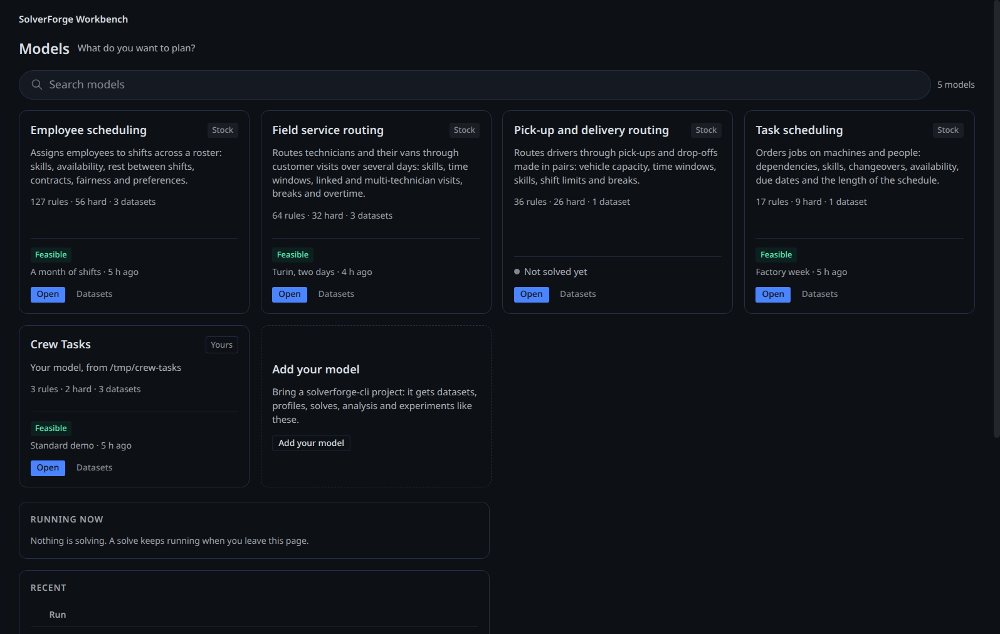
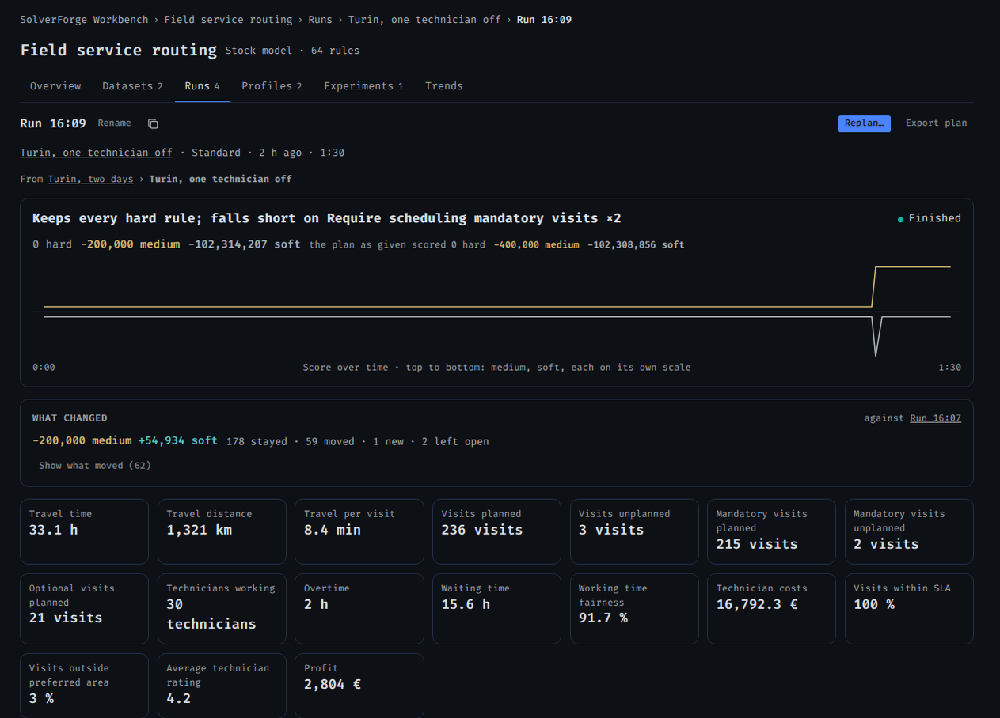
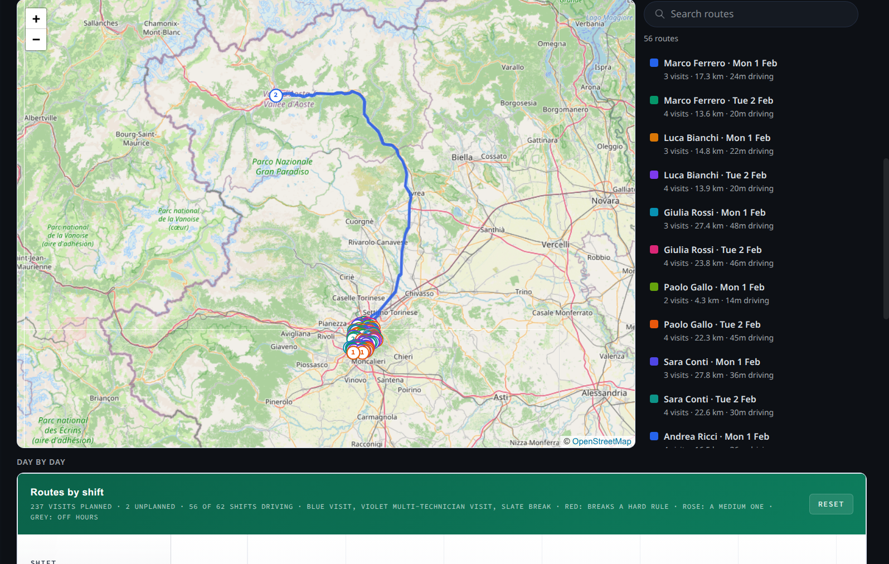
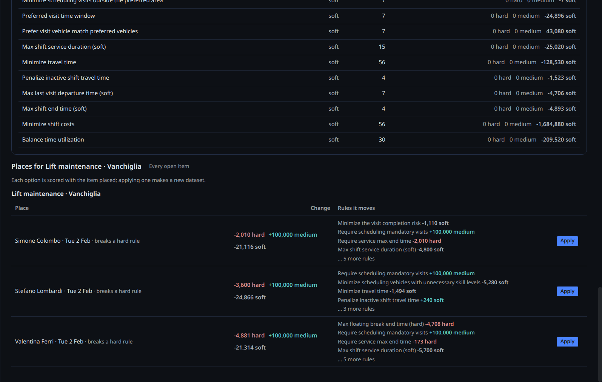
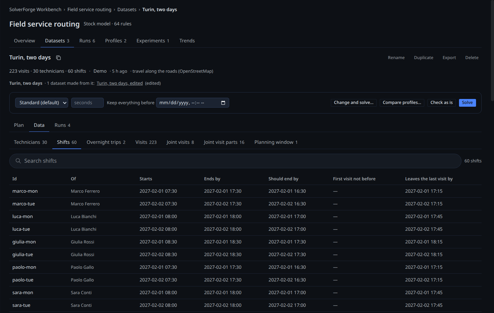
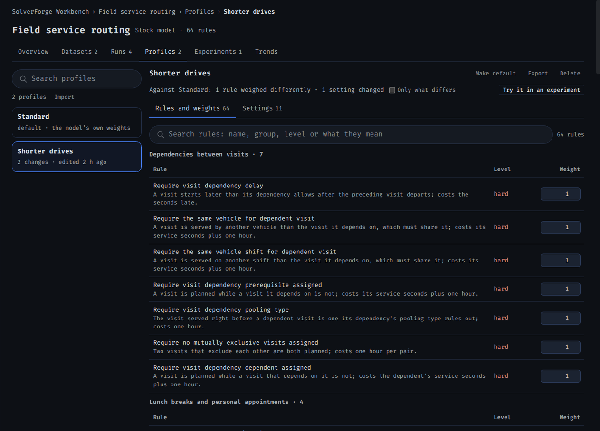
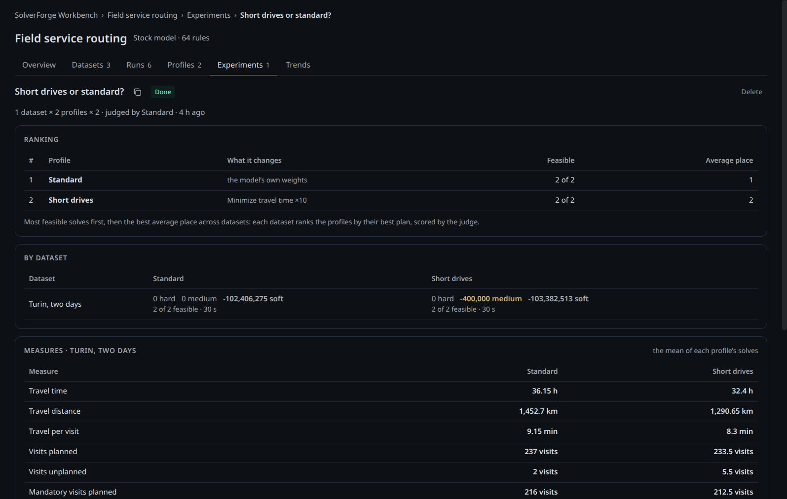
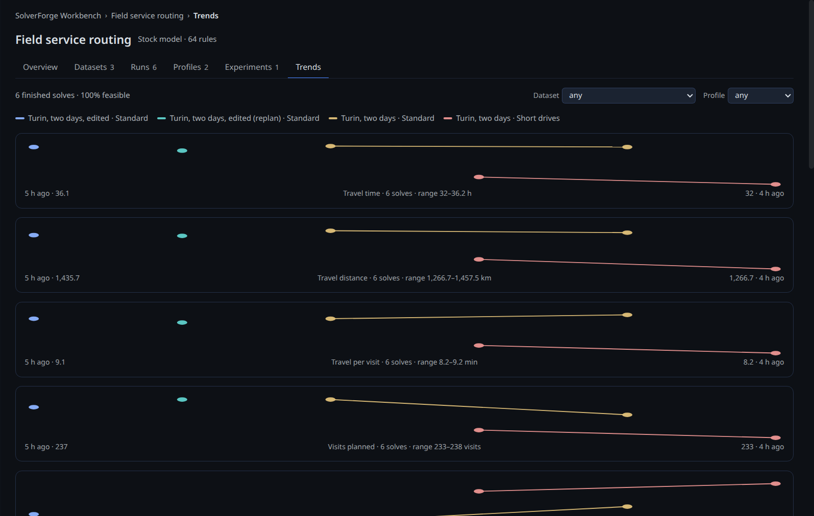
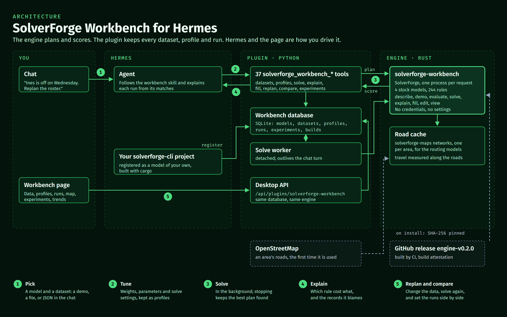

# SolverForge Workbench for Hermes

<p align="center"></p>

Optimization models you configure, solve and explain from Hermes, on your own
machine. Pick a model, load a dataset, tune what matters with constraint
weights and profiles, solve in the background, and read which rule cost what
and why. The Desktop shows each solved plan as a schedule, or on a map along
the roads.

https://github.com/user-attachments/assets/9b1a7415-4194-413d-9456-95e36495e4b8

## Try it

You need [Hermes Agent](https://github.com/NousResearch/hermes-agent) 0.22.2 or newer.

```sh
hermes plugins install blackopsrepl/hermes-solverforge-workbench --enable
hermes solverforge-workbench install
```

The second command downloads the engine for your computer (22 to 28 MB) and
checks it against a fingerprint pinned in the plugin. There is nothing else to
install: no Rust, no database, no account.

Current Hermes builds a session's tool list from the plugins it saw at the
previous launch, so run `hermes chat -q hi` once after installing. Then ask:

> “Show me the employee scheduling demo for a small ward and solve it.”
>
> “Why is Amina penalized in that run?”
>
> “Make a profile that cares twice as much about preferred hours and compare it with the standard one.”
>
> “Ines is sick on Wednesday. Replan from the published roster and keep everything else.”

**In the Desktop app**, open **Capabilities → Plugins** and turn on
SolverForge Workbench's Desktop features. **SolverForge Workbench** in the
sidebar then opens the same models, datasets and runs.

## Models

| Model | Constraints | What it plans |
| --- | --- | --- |
| Employee scheduling | 127: 56 hard, 3 medium, 68 soft, in 14 groups | Shifts to employees: skills and risks, availability, contract work limits over periods and rolling windows, time off, rotations and shift patterns, rest, travel and locations, teams and pairings, hourly demand, alternative shifts, cost, fairness and replanning |
| Task scheduling | 17: 9 hard, 1 medium, 7 soft, in 7 groups | Tasks to machines and people over time: time windows, dependencies, resource fit and hand-overs, changeovers, due dates, makespan and idle time |
| Pick-up and delivery routing | 36: 26 hard, 1 medium, 9 soft, in 12 groups | Multi-stop jobs to drivers' shifts and their order: stop order, vehicle capacity, time burden and pooling, skills and tags, breaks and appointments, time windows and SLAs, priorities, overtime and replanning |
| Field service routing | 64: 32 hard, 3 medium, 29 soft, in 17 groups | Visits to technicians' shifts and their order: skills and levels, tags, time windows and SLAs, breaks, visit dependencies, multi-technician visits, linked multi-day shifts, coverage areas, shift limits, cost, fairness and replanning |

Every constraint has a name, a group, a level and a description you can read
in the model's page or ask Hermes about. Each model ships one large demo that
uses its rules: a hospital month (50 employees, 536 shifts, three wards on two
sites), a factory week (24 machines and people, 409 operations), two days of
Milan patient transport and medical courier work (15 drivers, 155 jobs), and
two days of Turin building services (30 technicians, 223 visits and 8 joint
visits).

The two routing models travel on real roads: each dataset's travel times and
distances are measured along the OpenStreetMap road network with
[solverforge-maps](https://crates.io/crates/solverforge-maps), at each road's
own speed, and the map draws every route along the roads. A demo's network is
downloaded from the engine release the first time that demo is used; any
other dataset fetches its area's roads once and keeps them. A dataset may bring
its own travel matrix instead. Road data © OpenStreetMap contributors, ODbL.

### Your own models

A project made with [solverforge-cli](https://github.com/SolverForge/solverforge-cli)
becomes a model beside these: ask Hermes to register it, and the workbench reads
the project, builds its engine with cargo and gives it datasets, profiles,
solves, analysis, fill, a plan view of who holds what, experiments and trends.
It needs a Rust toolchain and the SolverForge release the workbench is built on;
constraint descriptions come from the doc comment on each constraint, and
constraint weights from a `#[constraint_weights]` field on the plan.

## What you can do

- **Datasets.** Each model's demos are ready as datasets; add yours from a JSON
  file or JSON in the chat. Change a
  dataset with a patch that addresses records by id
  (`/shifts/[id=S12]/employee`); the original stays and the new one records it
  as its parent. Replan from a solved run's plan.
- **Profiles.** Constraint weights (1 is as designed, 0 switches a rule off,
  10 makes it ten times as important), model parameters and solve settings
  (time limit, stop after no improvement, step limits, target score). Every
  model has a read-only Standard profile. Profiles export to and import from
  JSON.
- **Settings order.** Later wins: model defaults, parent dataset, profile,
  one-off overrides, the dataset's own settings.
- **Solving.** Solves run in a background worker, so they keep going after the
  chat turn ends; several can run at once and queue by priority. Stopping a
  solve keeps the best plan found. A dataset with errors is refused with each
  error named.
- **Evaluating.** Score a plan as it stands, without solving, to check a
  hand-made or real-world roster.
- **Explaining.** Per constraint: its score and the matches that caused it.
  Per entity: every match that involves an employee or a shift.
- **Comparing.** Two or more runs side by side: score, every constraint, the
  KPIs, profile and solve time.

## The Desktop

**SolverForge Workbench** in the sidebar opens every model, dataset, profile,
run and experiment; the command palette also opens it beside the chat. Every
list has a fuzzy search (`rst btwn` finds *Rest between shifts*).



- **A run** shows a verdict in words, the score and how far it moved, a
  score-over-time chart per level, the KPIs, the plan, and every constraint
  with the matches it blames. From there: replan with a change (a technician
  off for a day, a new visit, a moved time window), export, or compare.

  

- **Routes** fill the page on a map, along the roads, beside a searchable list
  of routes with their visits, distance and driving time. Picking a route zooms
  to it and dims the rest; an unplanned visit offers the best places for it.
  The day-by-day timeline follows below.

  

- **Fill** ranks the best places for an open item, each with what it changes
  per level and the rules it moves, and applies the one you pick as a new
  dataset.

  

- **Rosters and schedules** show one lane per employee or machine: red marks
  an assignment that breaks a hard rule, rose a medium one, grey is time off.
- **A dataset's data** opens as one grid per table (technicians, shifts,
  visits, breaks, contracts, calendars...) with typed cell editors for every
  field the model reads: working hours, lunch breaks, limits and costs
  included. Changes are staged, checked by the engine and saved as a new
  dataset, or in place while no run has used it.

  

- **Profiles** edit weights and parameters in place, each setting typed with
  its unit, and show what differs from Standard.

  

- **Experiments** solve every dataset under every profile, rank the profiles
  and show what each profile's plans come to in the model's measures;
  **trends** chart a model's solves over time, one series per dataset and
  profile.

  

  

- A `::solverforge-workbench{run="…"}` card in the chat shows what costs score
  in a run, and a status-bar chip counts running solves.

## Settings

Under **Settings → Plugins → SolverForge Workbench**
(`plugins.entries.solverforge-workbench.settings`):

| Key | Default | Meaning |
| --- | --- | --- |
| `binary` | empty | Use this engine binary instead of the installed one |
| `parallel_solves` | `0` | Solves at once; 0 picks a quarter of the machine's cores |

## What it downloads, runs and stores

- **The engine.** `hermes solverforge-workbench install` or
  `/solverforge-workbench install` downloads `solverforge-workbench-<platform>`
  from this repository's `engine-v0.2.1` release and refuses it unless its
  SHA-256 matches the value pinned in [`engine_bin.py`](engine_bin.py). Each
  binary carries a build attestation:
  `gh attestation verify solverforge-workbench-<platform> --repo blackopsrepl/hermes-solverforge-workbench`.
- **One program per solve.** The engine reads one JSON request on standard
  input and writes JSON lines on standard output. It starts with only the
  environment a process needs (no API keys reach it). The scheduling models
  make no network calls.
- **Road data, for the routing models only.** Opening a routing demo
  downloads its road network once from the same engine release, refused
  unless its SHA-256 matches the value pinned in `engine_bin.py`. Any other
  routing dataset sends its area's bounding box to the Overpass API once, and
  the roads are kept in the plugin's folder. The places themselves are routed
  on your machine.
- **Map tiles.** The Desktop's route map loads OpenStreetMap tiles; the tile
  servers see the visible area and your IP.
- **Custom models are built on your machine.** Registering a project runs
  `cargo build --release` on it and on the engine host shipped with the plugin;
  cargo downloads the crates they depend on from crates.io. The build gets only
  the environment cargo needs (paths, the cargo and rustup homes, proxies).
- **One folder.** `<hermes home>/plugin-data/solverforge-workbench/` holds
  the SQLite database (models, datasets, profiles, runs), the engine, and each
  custom model's generated engine crate and build.
  Removing the plugin keeps it; delete the folder to erase everything.
- Deleting a dataset, profile or experiment, or removing a custom model, from
  the chat asks you first, every time: the plugin's `pre_tool_call` hook holds
  it until you approve that one record. On the Desktop, the same delete asks
  in a dialog showing what goes with it.
- No credentials read or stored, no telemetry, and no process left running
  after a solve.

## How it works



- [`engine/`](engine) is a Rust workspace on the published `solverforge`
  crate. `host/` runs any SolverForge model behind one JSON-lines contract
  (describe, demo, solve with progress and cancel, evaluate); each stock model
  is its own crate under `models/`; `app/` is the `solverforge-workbench`
  binary that registers them. Scores, matches and KPIs come only from the
  engine.
- The Python plugin keeps the records, applies settings in their fixed order,
  queues solves for the detached worker and serves the Desktop half from the
  same tool handlers the agent uses.
- Score format `hard/medium/soft`, closer to zero is better. Hard rules must
  hold for a plan to be feasible, medium counts work left undone, soft weighs
  preferences and costs.

## Development

```sh
make check        # rustfmt, clippy, engine tests, plugin tests, Desktop tests, hermes validate + doctor
make install-dev  # install this checkout into Hermes, with the locally built engine
make dist-all     # cross-build every release binary with cargo-zigbuild
make              # all targets
```

The plugin tests run against `workbench-testkit`, a small real model in its own
engine binary, in real processes. The roster and search tests use the employee
scheduling engine's own output, captured by
[`tests/fixtures/make_roster_fixture.py`](tests/fixtures/make_roster_fixture.py).

## License

[Apache-2.0](LICENSE). Copyright 2026 Vittorio Distefano.
